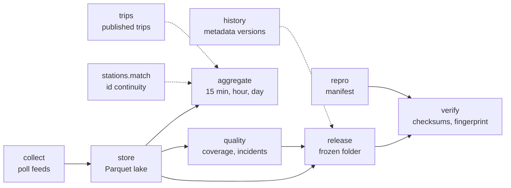

# Collect, store and release data (experimental)

!!! warning "Experimental"
    These modules were added in 2.1.0. They are public and tested, but their names, parameters and
    output columns may change in a minor release while they are used on more systems (see the
    [API policy](../api-policy.md)). Import each one by its path: `from gbfs_toolkit import quality`.
    Pin `gbfs-toolkit>=2.1,<2.2` if you build on them.

For a first walk through the whole chain, see the [tutorial](../tutorial.md); for one task at a time, the [recipes](../recipes/index.md). `aggregate`, `quality` and `store` accept a frame, an Arrow table, a DuckDB relation or a path, and read a folder in place.

The audit modules answer *is this feed trustworthy?* These ones answer *what did we collect, how
complete is it, and how do we hand it to someone who must be able to trust it?* They fit together
as a pipeline, and each step also works alone:



| Module | What it does | Page |
|---|---|---|
| `gbfs_toolkit.collect` | polls feeds politely (User-Agent, `ttl`, back-off), writes a fragment per poll and gathers closed days into one file per system and day, keeps missing values missing | [collect](collect.md) |
| `gbfs_toolkit.store` | a Hive-partitioned Parquet lake (system, year, month), common column names, UTC and local time, DuckDB views | [store](store.md) |
| `gbfs_toolkit.quality` | daily coverage and status per system, collection gaps, silent feeds, incident registry, ambiguity indicators | [quality](quality.md) |
| `gbfs_toolkit.aggregate` | availability by 15 minutes, hour or day, with fixed definitions and a conservation check | [aggregate](aggregate.md) |
| `gbfs_toolkit.history` | a dated version of a metadata feed, kept only when its content changes | [history](history.md) |
| `gbfs_toolkit.stations.match` | which station of this period is which of the last one | [stations.match](stations-match.md) |
| `gbfs_toolkit.trips` | published trip files (Lyft/Motivate, Urban Sharing, Bicycle Transit Systems, Vélomagg) into one schema | [trips](trips.md) |
| `gbfs_toolkit.release` | freeze a closed period into a folder with coverage, incidents, data package, README and checksums | [release](release.md) |
| `gbfs_toolkit.repro` | a content fingerprint and a manifest, verification, samples for CI | [repro](repro.md) |
| `gbfs collect / compact / quality / release / verify` | the same, from the command line | [command line](cli.md) |

Nothing here runs in the background, uploads anything, or needs more than the extras you
choose: `pip install "gbfs-toolkit[parquet]"` is enough for the files, `[fetch]` adds the
network, `[duckdb]` the SQL views and `[cli]` nicer terminal output.

## A complete example, offline

One system, a day of one-minute snapshots, a hole in the middle: store it, check it, aggregate it,
freeze it and verify the result. The data are synthetic, so this runs anywhere.

```python
import tempfile
from pathlib import Path

import numpy as np
import pandas as pd

from gbfs_toolkit.aggregate import aggregate_levels
from gbfs_toolkit.quality import add_quality_indicators, assess
from gbfs_toolkit.release import freeze_release, verify_release
from gbfs_toolkit.store import harmonize, read_lake, write_lake

work = Path(tempfile.mkdtemp())

# 1. Two days of snapshots for two systems; "lakeside" loses 6 hours on the first day.
rng = np.random.default_rng(0)
frames = []
for system in ("riverside", "lakeside"):
    minutes = pd.date_range("2026-03-01", periods=2 * 1440, freq="min", tz="UTC")
    if system == "lakeside":
        minutes = minutes[(minutes < "2026-03-01T06:00Z") | (minutes >= "2026-03-01T12:00Z")]
    for station in ("s1", "s2"):
        frames.append(pd.DataFrame({
            "system_id": system, "station_id": station, "fetched_at": minutes,
            "num_bikes_available": rng.integers(0, 12, len(minutes)),
            "num_docks_available": rng.integers(0, 12, len(minutes)),
            "capacity": 20,
        }))
raw = pd.concat(frames, ignore_index=True)

# 2. Flag the ambiguous rows, give the columns common names and write the lake.
flagged = add_quality_indicators(raw)
tidy = harmonize(flagged, tz="Europe/Paris")
write_lake(tidy, work / "lake", timezones={"riverside": "Europe/Paris", "lakeside": "Europe/Paris"})

# 3. How complete is it? (The window ends yesterday in real use; here the data end on the 2nd.)
report = assess(read_lake(work / "lake"), time_col="observed_at_utc", end="2026-03-02")
print(report.coverage[["date_utc", "system_id", "completeness_pct", "status"]].to_string(index=False))
print(report.incidents[["incident_id", "cause"]].to_string(index=False))

# 4. Quarter-hour, hourly and daily tables that all describe the same rows.
levels = aggregate_levels(tidy.rename(columns={"observed_at_utc": "fetched_at"}), tz="Europe/Paris")
print({name: int(table["n_obs"].sum()) for name, table in levels.items()})

# 5. Freeze the closed period and verify the folder, as a user of the release would.
info = freeze_release(work / "lake", work / "release", name="demo-2026-03",
                      start="2026-03-01", end="2026-03-02", license="CC0-1.0")
print(info["rows"], verify_release(work / "release", deep=True)["ok"])
```
